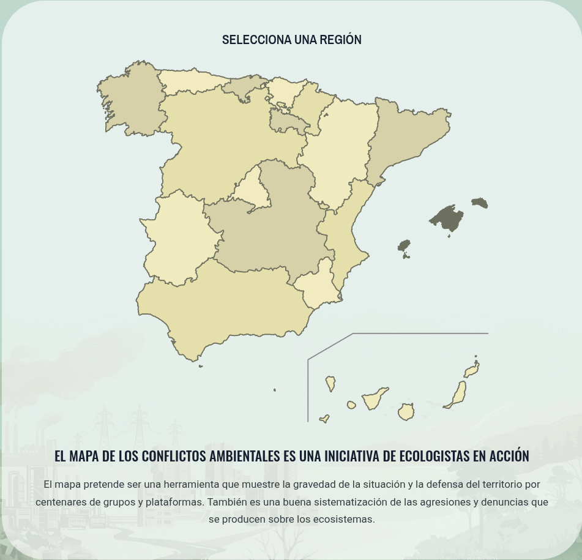

# Introducción

## Qué es el Mapa de Conflictos Ambientales

El Mapa de Conflictos Ambientales es una aplicación web desarrollada por [Ecologistas en Acción](https://www.ecologistasenaccion.org/) que permite visualizar y analizar las conflictos ambientales en el Estado español. Es una herramienta de sensibilización de la población y de denuncia ante las distintas administraciones y empresas responsables de los impactos ambientales. El mapa se nutre de la información aportada por personas colaboradoras y por el propio equipo editor, que verifica y valida los datos antes de su publicación.

{#fig-mapa width=80%}

## Qué se considera un conflicto ambiental

Los conflictos ambientales contemplados son agresiones al medio ambiente y a su biodiversidad y, por tanto, recogen acciones o actividades que han causado un daño relevante al entorno natural o sus poblaciones. También pueden incluirse proyectos o decisiones que amenazan con causar un daño ambiental significativo, aunque aún no se haya producido. En cualquier caso, el conflicto ambiental debe ser relevante y de interés público.

## Qué información recoge cada conflicto

Cada conflicto se describe con un conjunto fijo de campos, que son también los que permiten filtrar y agrupar la información:

| Campo | Descripción | Uso |
|--|----|--|
| Título | Nombre del conflicto | Identificación |
| Lugar | Comunidad autónoma, provincia y municipio | Mapa y filtros |
| Ubicación | Coordenadas geográficas | Mapa |
| Medios afectados | Agua, aire, caminos públicos, ecosistemas, espacios naturales protegidos, fauna, flora, paisaje, patrimonio, otros. | Filtro múltiple |
| Causa del conflicto | Agricultura, caza, energía, ganadería, incendio, industria, militar, minería, pesca, residuos, transporte, turismo, urbanismo, otros | Filtro múltiple |
| Nivel de gravedad | Alta, media o baja | Filtro y simbología |
| Fecha de inicio | Año o fecha de comienzo | Filtro temporal |
| Fecha de finalización | Año o fecha de finalización | Filtro temporal |
| Descripción | Relato del conflicto | Ficha |
| Actores | Personas, empresas o instituciones involucradas | Ficha |
| Acciones | Medidas adoptadas o propuestas para resolver el conflicto | Ficha |
| Respuesta institucional | Actuaciones de las administraciones públicas | Ficha |
| Imágen principal | Fotografía representativa del conflicto | Mapa y ficha |
| Galería de fotos | Imágenes adicionales del conflicto | Ficha |
| Documentación | Enlaces y documentos relacionados con el conflicto | Ficha |

: Campos principales de un conflicto {.striped .hover}

## Quién puede hacer qué

| Perfil | Consultar | Proponer | Editar | Publicar |
|---|:--:|:--:|:--:|:--:|
| Visitante | ✓ | — | — | — |
| Colaborador | ✓ | ✓ | ✓ (sus fichas) | — |
| Editor | ✓ | ✓ | ✓ | ✓ |

: Permisos por perfil {.striped}

