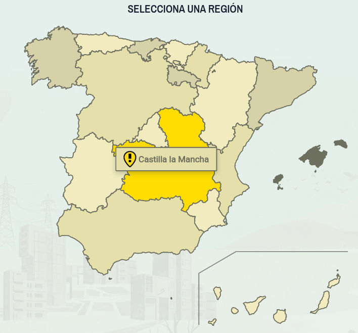
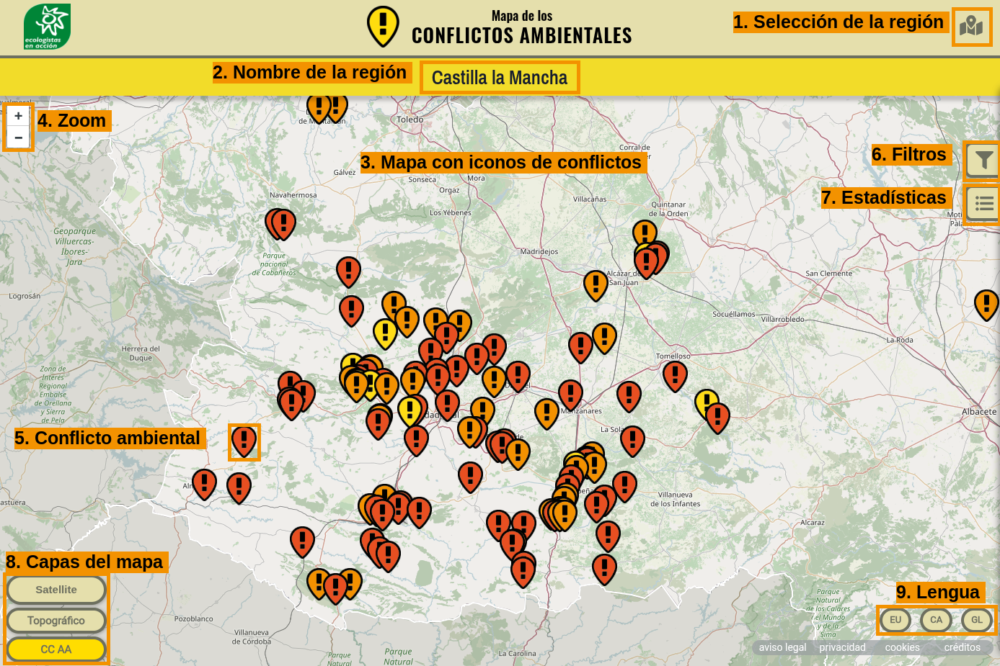

# Primeros pasos

## Requisitos

- Un navegador actualizado (Firefox, Chrome, Edge o Safari).
- Conexión a internet; el mapa carga la cartografía en línea.
- Para colaborar, una cuenta en el área de gestión (ver [Acceso al área de gestión](07-acceso-area-gestion.qmd)).

::: {.callout-tip}
## Uso en el móvil
El sitio es adaptable, y está pensado para poder usarse en dispositivos móviles para añadir conflictos sobre el terreno, pero para visualizar los conflictos se recomienda usar pantallas grandes. 
:::

## Acceder a la aplicación

::: {.pasos}
1. Abre [https://conflictosambientales.ecologistasenaccion.org](https://conflictosambientales.ecologistasenaccion.org).
2. Selecciona una región en el mapa
:::

{width="50%"}

::: {.callout-warning}
El mapa de la región seleccionada tarda unos segundos en cargarse, así que hay que tener un poco de paciencia.
:::

## La interfaz de usuaria

{#fig-inicio .captura width=100%}

| Zona | Elemento | Para qué sirve |
|-|---|------|
| 1 | Selección de la región | Botón para elegir la comunidad autónoma que se quiere consultar. |
| 2 | Nombre de la región | Indica la región que se muestra actualmente en el mapa. |
| 3 | Mapa con iconos de conflictos | Muestra la ubicación de los conflictos de la región seleccionada. |
| 4 | Zoom | Botones + y − para acercar o alejar el mapa. |
| 5 | Conflicto ambiental | Icono que marca la posición de un conflicto; el color indica su nivel de gravedad. |
| 6 | Filtros | Botón para filtrar los conflictos mostrados en el mapa. |
| 7 | Estadísticas | Botón para consultar el listado y las estadísticas de los conflictos. |
| 8 | Capas del mapa | Botones para cambiar el mapa base (satélite, topográfico, etc.). |
| 9 | Lengua | Botones para cambiar el idioma de la interfaz (EU, CA, GL). |

: Zonas de la pantalla de inicio {.striped}
