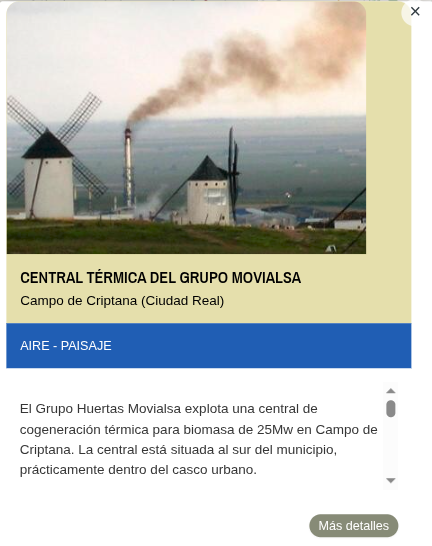
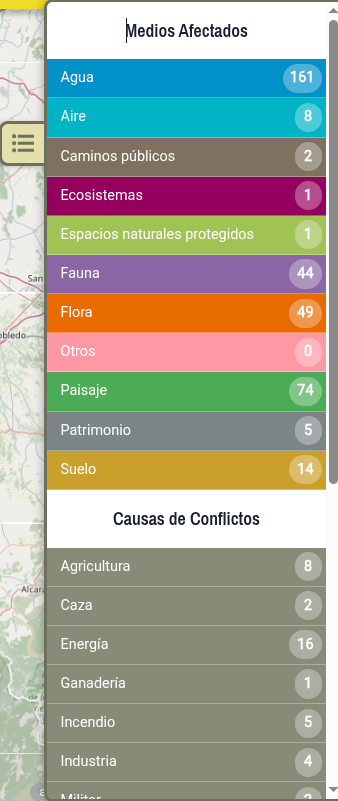

# Interacción con el mapa

## Seleccionar la región

Lo primero de debemos hacer es seleccionar la región que queremos explorar. Hay dos formas posibles de hacerlo:

1.  Haz clic sobre la región en el mapa de la página principal.
2.  Haz clic en el botón de selección de región (1) y elige la región en el desplegable.

## Navegar por el mapa

Existen distintas formas de desplazarse por el mapa y acercar o alejar la vista:

1. Haz clic y arrastra con el ratón para desplazar el mapa.
2. Usa la rueda del ratón o los botones [+]{.ui} y [−]{.ui} para acercar y alejar.
3. Haz doble clic sobre una zona para ampliarla.

## Capas del mapa

El mapa incorpora 3 capas que pueden activarse o desactivarse haciendo clic sobre ellas:

- **Satélite**: Muestra la imagen satélite de la zona.
- **Mapa**: Muestra el mapa base con carreteras, ríos y ciudades.
- **CC AA**: Muestra los límites de las comunidades autónomas y provincias.

## Leyenda y simbología

| Símbolo | Significado |
|---|-----|
| Chincheta roja | Conflicto de gravedad [alta]{.gravedad-alta} |
| Chincheta ámbar | Conflicto de gravedad [media]{.gravedad-media} |
| Chincheta amarilla | Conflicto de gravedad [baja]{.gravedad-baja} |
| Círculo con número | Agrupación de varios conflictos cercanos |

: Simbología del mapa {.striped}

## Seleccionar un conflicto

Al hacer clic sobre el icono de un conflicto se muestra una ventana emergente con la información más relevante sobre el conflicto ambiental y un enlace a la ficha completa del conflicto (botón [Más detalles]{.ui}).

## Estadísticas de conflictos ambientales

Se puede acceder a un resumen estadístico con el número de conflictos registrados en el mapa, clasificados por medio afectado, causa y nivel de gravedad, haciendo clic en el botón {width="20px"}.

{width="40%"}