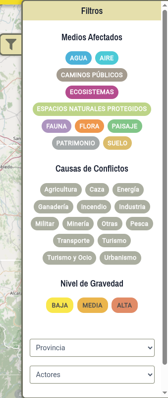

# Buscar y filtrar conflictos

La aplicación permite localizar conflictos ambientales haciendo clic sobre el botón de filtros . Esto abre un panel lateral con los filtros disponibles.

{width="40%"}

## Los filtros disponibles

| Filtro | Tipo | Valores |
|---|---|---|
| Medio afectado | Casillas (varias a la vez) | Agua, aire, caminos públicos, ecosistemas, espacios naturales protegidos, fauna, flora, paisaje, patrimonio, suelo, otros |
| Causa del conflicto | Casillas (varias a la vez) | Agricultura, caza, energía, ganadería, incendio, industria, militar, minería, pesca, residuos, transporte, turismo y ocio, urbanismo, otras |
| Nivel de gravedad | Casillas | Alta, media, baja |
| Provincia | Lista desplegable | Depende de la comunidad elegida |
| Actores | Lista desplegable | Personas, empresas e instituciones involucradas en el conflicto. |

: Filtros del archivo de conflictos {.striped .hover tbl-colwidths="[22,22,56]"}

## Aplicar un filtro

::: {.pasos}
1. Marca las casillas de **Medios Afectados**. Se puede marcar más de una. 
2. Marca las casillas de **Causa de Conflictos**. Se puede marcar más de una.
3. Marca el **Nivel de Gravedad*.
4. Los resultados se recargan automáticamente al cambiar cualquier filtro.
:::

Para desactivar los filtros puedes hacer clic en el botón [Reiniciar filtros]{.ui}.

