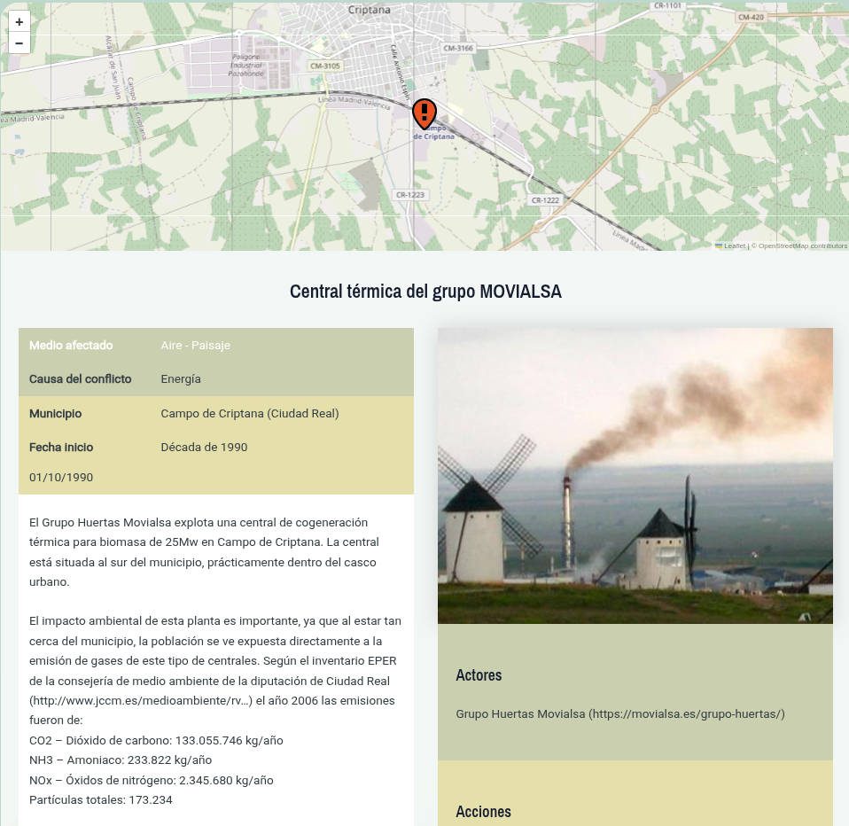

# Ficha del conflicto

Al hacer clic en el botón [Más detalles]{.ui} de la ventana emergente de un conflicto ambiental se abre su ficha.

La ficha del conflicto contiene toda la información disponible sobre el conflicto ambiental seleccionado.

## Elementos de la ficha

| Bloque | Contenido |
|---|---|
| Cabecera | Título, localización y nivel de gravedad. |
| Mapa de situación | Punto exacto del conflicto. |
| Localización | Provincia y municipio. |
| Medio afectado | Agua, aire, caminos públicos, ecosistemas, espacios naturales protegidos, fauna, flora, paisaje, patrimonio, suelo, otros. |
| Causa del conflicto | Agricultura, caza, energía, ganadería, incendio, industria, militar, minería, pesca, residuos, transporte, turismo y ocio, urbanismo, otras. |
| Cronología | Fecha de inicio y final del conflicto.|
| Descripción | Relato de los hechos y estado actual. |
| Actores | Personas, empresas e instituciones involucradas. |
| Galería | Fotografías y vídeos del conflicto. |
| Documentación | Enlaces de prensa y documentos relacionados. |

: Bloques de la ficha {.striped .hover tbl-colwidths="[28,72]"}

