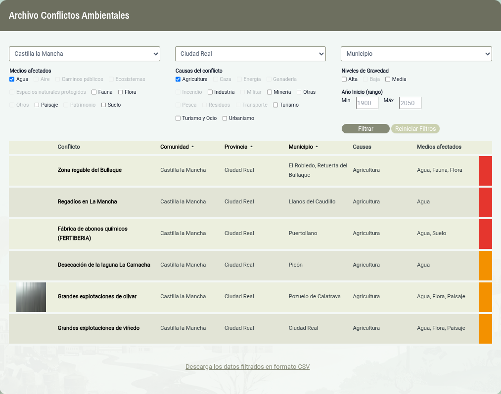

# Compartir, citar y exportar

## Compartir un conflicto

Cada ficha y cada búsqueda filtrada tienen una dirección propia: copia la URL de la barra del navegador para compartir exactamente lo que estás viendo.

También se puede compartir haciendo clic en el botón [Compartir]{.ui} de la ficha.

::: {.callout-tip appearance="simple"}
Los filtros aplicados quedan recogidos en la dirección, así que el enlace
reproduce la misma selección en quien lo abra.
:::

## Citar el mapa

Si quieres citar el mapa o un conflicto ambiental en un informe otrabajo académico, puedes usar la siguiente referencia:

> . **.
> Disponible en  \[consulta: fecha\].

## Imprimir o guardar en PDF

::: {.pasos}
1. Abre la ficha o el listado que quieras conservar.
2. Pulsa <kbd>Ctrl</kbd> + <kbd>P</kbd> (<kbd>Cmd</kbd> + <kbd>P</kbd> en macOS).
3. Elige *Guardar como PDF* en el destino de impresión.
:::

## Descarga de datos

Es posible exportar los datos de los conflictos ambientales en formato CSV. Para ello hay que hacer clic en el botón de selección de región  y después hacer clic en el cuadro desplegable en el botón [Archivo Conflictos]{.ui}.

Con ello se accede a la página del archivo de conflictos, donde se pueden filtrar los conflictos y descargar los conflictos seleccionados en formato CSV haciendo clic en el enlace que aparece abajo [Descargar los datos filtrados en formato CSV]{.ui}.

