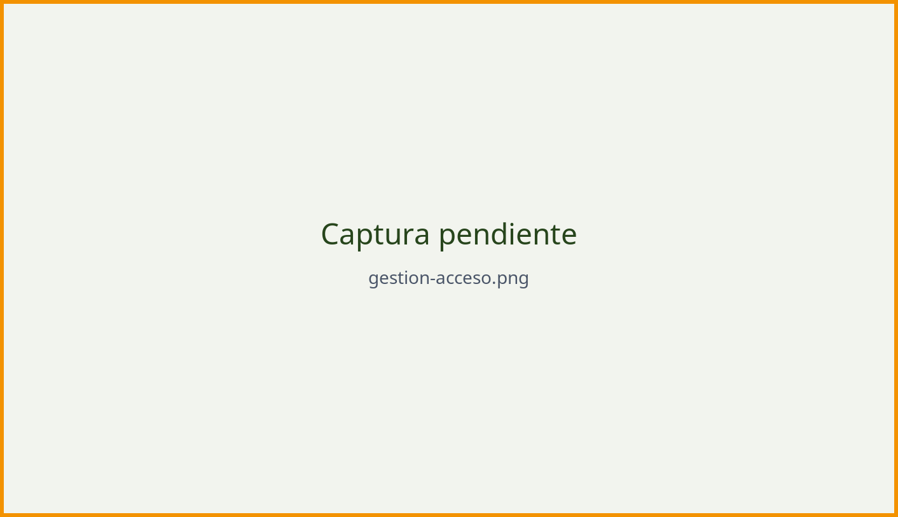

# Acceso al área de gestión

El área de gestión () es la zona privada donde los grupos
y plataformas registran y actualizan sus conflictos.

## Obtener una cuenta

*(pendiente)* Explica cómo se solicita el alta, quién la aprueba y qué datos se
piden.

## Iniciar sesión

::: {.pasos}
1. Entra en .
2. Escribe tu **usuario o correo** y tu **contraseña**.
3. Pulsa [Acceder]{.ui}.
:::

{#fig-acceso .captura width=70%}

## Recuperar la contraseña

::: {.pasos}
1. En el formulario de acceso, pulsa [¿Olvidaste la contraseña?]{.ui}.
2. Indica el correo asociado a la cuenta.
3. Abre el mensaje recibido y define una contraseña nueva.
:::

::: {.callout-warning}
## Seguridad de la cuenta
Usa una contraseña larga y exclusiva para este sitio, no compartas la cuenta
entre varias personas y cierra la sesión en equipos compartidos.
:::

## El escritorio de gestión

*(pendiente)* Describe lo que se ve tras acceder: listado de conflictos propios,
estados, buscador interno y botón para crear uno nuevo.

## Perfiles y permisos

*(pendiente)* Detalla qué puede hacer cada perfil (colaboración, edición,
coordinación territorial) y a quién dirigirse para ampliar permisos.
