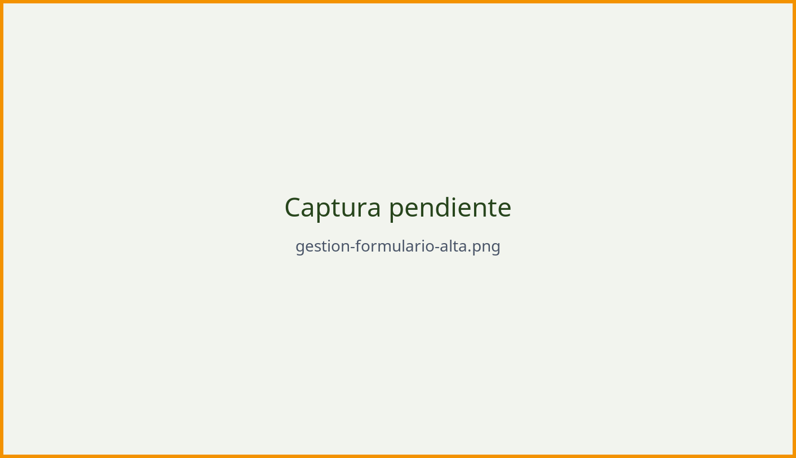

# Dar de alta un conflicto

## Antes de empezar

Reúne esta información; así completarás el formulario de una sola vez:

- Título claro y localización (comunidad, provincia, municipio).
- Coordenadas o referencia precisa del lugar.
- Descripción de los hechos y fecha de inicio.
- Medio afectado, causa y nivel de gravedad.
- Entidades implicadas y datos de contacto.
- Enlaces a noticias, documentos administrativos e imágenes con licencia.

## El formulario paso a paso

::: {.pasos}
1. En el escritorio de gestión, pulsa [Añadir conflicto]{.ui}.
2. Completa el bloque **Identificación**: título y resumen.
3. Completa **Localización**: comunidad, provincia, municipio y punto en el mapa.
4. Completa **Clasificación**: medio afectado, causa y nivel de gravedad.
5. Redacta la **Descripción** y añade la **fecha de inicio**.
6. Añade **entidades, enlaces y documentos**.
7. Guarda como [Borrador]{.ui} o envía a [Revisión]{.ui}.
:::

{#fig-alta .captura width=95%}

## Campos obligatorios

| Campo | ¿Obligatorio? | Notas |
|---|:--:|---|
| Título | Sí | Breve y descriptivo, sin siglas |
| Comunidad autónoma | Sí | Determina provincia y municipio |
| Municipio | Sí | *(pendiente de confirmar)* |
| Coordenadas | Sí | Ver apartado siguiente |
| Medio afectado | Sí | Puede marcarse más de uno |
| Causa del conflicto | Sí | Puede marcarse más de una |
| Nivel de gravedad | Sí | Según los criterios acordados |
| Fecha de inicio | Recomendado | Al menos el año |
| Descripción | Sí | Entre 1.000 y 3.000 caracteres *(orientativo)* |

: Campos del formulario de alta *(pendiente de confirmar)* {.striped .hover}

## Situar el conflicto en el mapa

*(pendiente)* Explica cómo se fija el punto: búsqueda por dirección, clic sobre
el mapa o introducción de latitud y longitud.

::: {.callout-important}
## Ubicaciones sensibles
Si localizar con exactitud el punto puede poner en riesgo a una especie, un
yacimiento o a las personas denunciantes, usa una referencia aproximada y
explícalo en la descripción.
:::

## Qué ocurre al enviar

*(pendiente)* Describe el circuito de revisión: quién lo valida, en cuánto
tiempo y cómo se avisa de la publicación.
